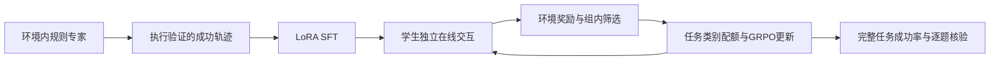
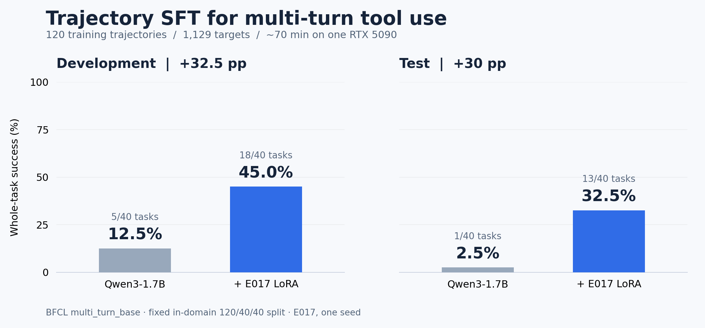
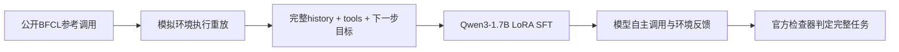

# 小模型 Agent 能力增强：轨迹 SFT 与在线 GRPO

**消费级单卡上的 Agent 后训练闭环：环境验证的专家轨迹 → LoRA SFT → 在线 GRPO → 完整任务评测。**

基于 **Qwen2.5-1.5B-Instruct**，使用 **600条经环境执行验证的规则专家轨迹**进行 LoRA SFT，再通过在线交互采样、组内奖励差异筛选和任务类别配额开展强化学习。ALFWorld六类任务的完整成功率由 Base 的 **6.25%** 提升至 SFT 的 **68.75%**，GRPO进一步提升至 **89.58%**，较SFT提高 **20.83个百分点**。

[English](README.en.md) · [最新版本与复现](experiments/alfworld/releases/v0.3.0/README.md) · [模型下载](https://github.com/ttxttx1111/trajectory-sft-agents/releases/tag/v0.3.0) · [训练数据](experiments/alfworld/data/) · [逐题结果](experiments/alfworld/releases/v0.3.0/results/) · [简历表述](docs/RESUME.md)


## ALFWorld：SFT＋GRPO

| 模型阶段 | 完整任务成功率 |
|---|---:|
| Base | 6.25%（3/48） |
| SFT | **68.75%（33/48）** |
| SFT＋GRPO | **89.58%（43/48）** |

各阶段采用相同任务和执行协议，每题执行一次完整任务，由环境终局状态判定成功。该数据用于开发与选模型；划分、解码和按类别结果见[实验说明](experiments/alfworld/releases/v0.3.0/README.md)。

- **可执行的监督数据。** 规则专家在TextWorld环境中生成600条成功轨迹，展开为10,461个决策样本；只对assistant动作计算loss，观察保留在输入中。
- **真实在线强化学习。** 同题独立环境采样，动态筛选组内成功/失败兼有的轨迹组，按任务类别配额入训；持续恢复LoRA与AdamW状态，并检查采样策略、旧概率与训练权重一致性。
- **覆盖六类任务的结果。** 简单放置、照明、清洗、加热、冷却和双物体任务均纳入评测；公开逐题执行记录、逐类表现、失败分析及16×8 / 32×8 / 16×16规模对照。
- **完整的开源产物。** 发布专家数据、训练轨迹、源码、SFT及RL adapter、续训起点与优化器状态、文件哈希及CPU核验入口；一张32GB显卡即可运行原训练流程。



```bash
# 不下载模型、不运行GPU：核对数据、奖励组及新旧逐题成绩
python scripts/verify_alfworld_release.py
```

SFT训练约26.8分钟。后续经过多轮在线训练和规模探索得到当前结果，分阶段成本在[版本报告](experiments/alfworld/releases/v0.3.0/README.md#训练成本与规模对照)列出。早期三轮RL的118分钟不代表最终模型的总训练时间。历史E068版本与BFCL E017版本均完整保留，当前研究阶段已结束。

## BFCL：已发布的轨迹SFT基线（E017）

**用120条参考轨迹，让1.7B模型学会更好地完成多轮工具任务。**

[](https://github.com/ttxttx1111/trajectory-sft-agents/actions/workflows/verify.yml)
[](LICENSE)
[](docs/MODEL_CARD.md)

[English](README.en.md) · [数据集](data/README.md) · [复现指南](docs/REPRODUCING.md) · [模型权重](https://github.com/ttxttx1111/trajectory-sft-agents/releases/tag/v0.1.0-e017) · [实验报告](docs/RESULTS.md)

这是一个从数据构造、LoRA训练到工具环境闭环评测的完整项目。在BFCL `multi_turn_base`的固定域内划分上，使用**完整历史 + 下一步动作监督 + 每轮停止动作**，将Qwen3-1.7B的测试任务成功率从 **2.5%提升至32.5%（+30个百分点）**。训练使用一张RTX 5090，耗时约70分钟，无需强化学习或付费模型API。

本仓库发布经过复核的 **E017** 实验快照，包含可读轨迹、原始训练样本、LoRA权重、原版核心代码和逐任务评测记录。

后续实验使用独立运行目录；版本维护说明见[这里](docs/MAINTAINING.md)。



## 结果

| 多轮闭环评测 | Qwen3-1.7B | + E017 LoRA | 提升 |
|---|---:|---:|---:|
| 开发集，40个任务 | 5/40 · 12.5% | **18/40 · 45.0%** | **+32.5 pp** |
| 测试集，40个任务 | 1/40 · 2.5% | **13/40 · 32.5%** | **+30.0 pp** |
| 测试集质量审计子集，30个任务 | 1/30 · 3.3% | **10/30 · 33.3%** | **+30.0 pp** |

测试集配对比较中，**12个任务由失败变为成功，0个由成功变为失败**；增益的组件聚类bootstrap 95%区间为 **+16.3～+45.0 pp**。审计子集是对同一批输出的事后敏感性分析，没有另行训练。数据划分为120/40/40个任务家族，近重复关联家族留在同一划分。完整结果和统计口径见[实验报告](docs/RESULTS.md)。

## 通用能力保持与域外评测

除BFCL域内任务外，我们还比较了同一基座与E017在两个通用能力数据集、一个域外工具调用数据集上的表现：

| 类别 | 数据集与样本量 | Qwen3-1.7B | + E017 LoRA | 变化 | 配对95%增益区间 |
|---|---|---:|---:|---:|---:|
| 通用能力 | ARC-Challenge，100题 | 35/100 · 35% | **38/100 · 38%** | **+3.0 pp** | −2.0～+8.0 pp |
| 通用能力 | HellaSwag，100题 | 65/100 · 65% | 64/100 · 64% | −1.0 pp | −5.0～+2.0 pp |
| 域外工具调用 | ToolACE，80个决策样本 | 43/80 · 53.75% | **45/80 · 56.25%** | **+2.5 pp** | −7.5～+12.5 pp |

**在域内Agent任务取得明显提升的同时，当前小样本通用能力评测未观察到明显退化；ARC-Challenge与域外ToolACE还出现了小幅正向变化。** 三项变化的95%区间均包含0，因此这些结果支持初步的能力保持观察，尚不能确认域外提升，也不构成“完全无损”的证明。ToolACE衡量完整下一步工具调用匹配，不等同于BFCL多轮任务成功率。

这些是E017已有的配对评测结果，未因本次公开展示重新训练或挑选新样本。[原始统计记录](results/reference/ood_retention/analysis.json)与[完整实验报告](docs/RESULTS.md)可供核查。

## 项目亮点

- **从模仿动作到实际完成任务。** 推理时模型自主选择工具、填写参数、读取真实的模拟环境返回并继续决策，最后由原版BFCL检查器判定整项任务是否完成。
- **可复用的轨迹数据工程。** 重放公开参考调用，保留完整历史，构造685个工具调用目标和444个停止目标；不截断上下文，只对当前assistant目标计算loss。
- **消费级单卡训练。** BF16 LoRA，1.7B基座，3个epoch；训练峰值CUDA allocated memory约12.41 GiB。先测基座、检查执行环境，再进行最长样本反向传播预检和训练。
- **可核查的证据链。** 固定数据划分、上游版本和文件哈希；公开全部160条Base/LoRA开发集与测试集rollout。CPU即可用原版检查器重新核算保存的结果。



## 先验证，再运行模型

无需GPU、无需下载模型，即可验证数据和历史成绩：

```bash
git clone https://github.com/ttxttx1111/trajectory-sft-agents.git
cd trajectory-sft-agents
python -m pip install -r requirements-check.txt
python -m unittest discover -s tests -v
python scripts/verify_release.py --replay
```

预期返回 `"passed": true` 和 `"official_saved_rollouts_replayed": 160`。这一步**重新执行保存的工具调用并核算成绩**；要重新生成模型回答，请按[复现指南](docs/REPRODUCING.md)安装GPU环境，随后运行：

```bash
python scripts/reproduce.py download
python scripts/reproduce.py evaluate --run smoke --arm base --split dev --limit 2
python scripts/reproduce.py evaluate --run smoke --arm tuned --split dev --limit 2
```

`--limit 2`用于检查环境；删除它才是完整40任务评测。新输出写入 `runs/<name>/`，不会覆盖 `results/reference/` 中的发布结果。

## 数据与权重

| 产物 | 内容 |
|---|---|
| [完整轨迹](data/train_trajectories.jsonl.gz) | 120条，包含工具schema、完整消息序列与assistant目标标记 |
| [可读决策样本](data/train_decisions.jsonl.gz) | 1,129条 `history → candidate_action`，可以直接检查和二次处理 |
| [原始token化训练数据](data/E017_bfcl_indomain/train_R.jsonl.gz) | E017实际使用的输入和loss边界；固定Qwen tokenizer |
| [真实样本示例](data/example.json) | 带工具返回的下一步工具调用目标 |
| [模型Release](https://github.com/ttxttx1111/trajectory-sft-agents/releases/tag/v0.1.0-e017) | 约65 MB的LoRA压缩包，配套校验哈希 |
| [训练与评测记录](results/reference/) | 原始训练日志、Base门禁、逐任务rollout、统计结果 |

**结果适用范围：** 这是公开BFCL任务的域内训练与内部留出评测，说明这套轨迹SFT配方能够增强该工具域的任务完成能力。ToolACE小样本域外测试尚无可靠增益，ARC/HellaSwag检查未观察到明显的大幅退化。E017保留原参考监督目标，执行重放通过不等于每一步语义都正确；单seed、历史任务接触记录等具体边界统一说明在[实验报告](docs/RESULTS.md)，不将此结果表述为官方盲测榜单成绩或通用Agent能力提升。

## 仓库结构

```text
data/                 可读轨迹、token化目标、固定划分、审计子集ID
scripts/              原版核心代码 + 隔离运行的公开入口
results/reference/    E017固定结果与原始rollout
configs/              上游模型、BFCL版本与adapter校验信息
vendor/gorilla/       Apache-2.0授权的最小离线BFCL运行子集
docs/                 数据/模型/方法说明、结果与复现指南
tests/                CPU运行边界测试
```

## 许可与引用

项目代码及本仓库发布的BFCL派生数据采用 **Apache-2.0**，保留上游来源与许可声明。基础模型来自[Qwen3-1.7B](https://huggingface.co/Qwen/Qwen3-1.7B)，环境和参考任务来自[Gorilla / BFCL](https://github.com/ShishirPatil/gorilla)。详见[NOTICE](NOTICE)、[数据卡](data/README.md)、[模型卡](docs/MODEL_CARD.md)。这是独立研究项目，与上游团队无隶属关系。

引用本版本可使用仓库的[CITATION.cff](CITATION.cff)。
