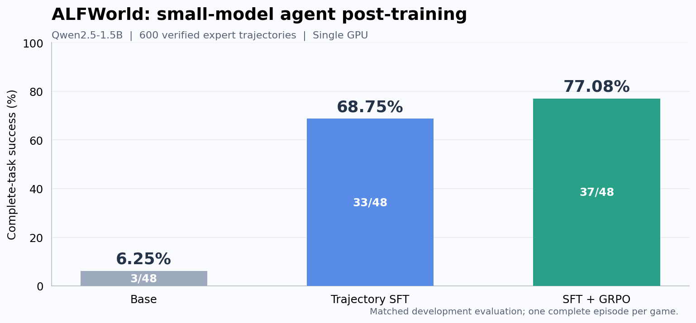

# 小模型 Agent 能力增强：轨迹 SFT 与在线 GRPO

**消费级单卡上的 Agent 后训练闭环：环境验证的专家轨迹 → LoRA SFT → 在线 GRPO → 完整任务评测。**

基于 **Qwen2.5-1.5B-Instruct**，使用 **600条经环境执行验证的规则专家轨迹**进行 LoRA SFT，再通过在线交互采样、组内奖励差异筛选和任务类别配额开展强化学习。ALFWorld六类任务的完整成功率由 Base 的 **6.25%** 提升至 SFT 的 **68.75%**，GRPO进一步提升至 **89.58%**，较SFT提高 **20.83个百分点**。

[English](README.en.md) · [最新版本与复现](experiments/alfworld/releases/v0.3.0/README.md) · [模型下载](https://github.com/ttxttx1111/trajectory-sft-agents/releases/tag/v0.3.0) · [训练数据](experiments/alfworld/data/) · [逐题结果](experiments/alfworld/releases/v0.3.0/results/) · [简历表述](docs/RESUME.md)



## ALFWorld：SFT＋GRPO

| 模型阶段 | 完整任务成功率 |
|---|---:|
| Base | 6.25%（3/48） |
| SFT | **68.75%（33/48）** |
| SFT＋GRPO | **89.58%（43/48）** |

各阶段采用相同任务和执行协议，每题执行一次完整任务，由环境终局状态判定成功。该数据用于开发与选模型；划分、解码和按类别结果见[实验说明](experiments/alfworld/releases/v0.3.0/README.md)。

- **可执行的监督数据。** 规则专家在TextWorld环境中生成600条成功轨迹，展开为10,461个决策样本；只对assistant动作计算loss，观察保留在输入中。
- **真实在线强化学习。** 同题独立环境采样，动态筛选组内成功/失败兼有的轨迹组，按任务类别配额入训；持续恢复LoRA与AdamW状态，并检查采样策略、旧概率与训练权重一致性。
- **覆盖六类任务的结果。** 简单放置、照明、清洗、加热、冷却和双物体任务均纳入评测；公开逐题执行记录、逐类表现、失败分析及16×8 / 32×8 / 16×16规模对照。
- **完整的开源产物。** 发布专家数据、训练轨迹、源码、SFT及RL adapter、续训起点与优化器状态、文件哈希及CPU核验入口；一张32GB显卡即可运行原训练流程。


```bash
# 不下载模型、不运行GPU：核对数据、奖励组及新旧逐题成绩
python scripts/verify_alfworld_release.py
```

SFT训练约26.8分钟。后续经过多轮在线训练和规模探索得到当前结果，分阶段成本在[版本报告](experiments/alfworld/releases/v0.3.0/README.md#训练成本与规模对照)列出。早期三轮RL的118分钟不代表最终模型的总训练时间。当前研究阶段已结束。


## 快速核验

```bash
git clone https://github.com/ttxttx1111/trajectory-sft-agents.git
cd trajectory-sft-agents
python -m unittest discover -s tests -v
python scripts/verify_release.py
python scripts/verify_alfworld_release.py
```

这些步骤只使用Python标准库核对保存的数据和文件，不需要GPU。模型下载、训练与评测见[当前版本复现指南](experiments/alfworld/releases/v0.3.0/README.md#复现)。

## 仓库结构

```text
experiments/alfworld/data/             600条专家轨迹及SFT决策数据
experiments/alfworld/releases/v0.3.0/   当前结果、训练轨迹、配置与复现入口
experiments/alfworld/scripts/          采样、SFT、GRPO与评测实现
experiments/alfworld/vendor/           固定版本的环境与运行库
scripts/                              绘图与CPU核验
docs/                                 简历描述与维护说明
```

## 许可与引用

项目代码采用[Apache-2.0](LICENSE)。基础模型来自[Qwen2.5-1.5B-Instruct](https://huggingface.co/Qwen/Qwen2.5-1.5B-Instruct)，任务与环境来自[ALFWorld](https://github.com/alfworld/alfworld)，运行库与GRPO核心函数基于[verl-agent](https://github.com/langfengQ/verl-agent)，保留随附上游许可，详见[NOTICE](NOTICE)与[CITATION.cff](CITATION.cff)。
